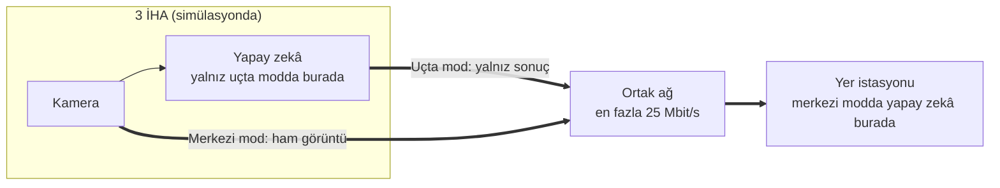

# Afet Bölgelerinde Haberleşme Altyapısından Bağımsız Olarak Çalışabilen Uçta Yapay Zekâ Destekli İHA Sürüsü

Bilgisayar Mühendisliği Proje Tasarımı dersi projesi.

**[Proje nedir?](#proje-nedir) · [Kurulum öncesi](#kurulum-öncesi) · [Kurulum](#kurulum) · [Ne kadarı bitti?](#ne-kadarı-bitti) · [Mimari](#mimari) · [Sorun mu var?](#sorun-mu-var)**

---

## Proje nedir?

Bir deprem ya da sel olduğunda internet ve cep telefonu şebekesi çalışmayabilir. Bu projede, **3 insansız hava aracının (İHA)** böyle bir bölgede internete ihtiyaç duymadan, sadece kendi aralarındaki yerel ağla birlikte çalışması **bilgisayarda simüle edilir**. İHA'lar bölgeyi tarar ve kameralarıyla **insanları ve enkaz yığınlarını** bulmaya çalışır.

**Asıl soru şu: İHA'nın kamerasından aldığı görüntüyü kim işlesin?**

| Mod | Ne olur? |
|---|---|
| **Uçta mod** | Her İHA görüntüyü **kendi üzerinde** yapay zekâyla işler. Merkeze yalnızca sonucu gönderir ("burada bir insan var"). |
| **Merkezi mod** | İHA görüntüyü olduğu gibi **yer istasyonuna** gönderir. Yapay zekâ orada çalışır. |

İki modu **aynı sahnede ve aynı ağ kapasitesiyle (25 Mbit/s)** çalıştırıp şunları karşılaştırıyoruz:

| Ölçüt | Ne demek? |
|---|---|
| Veri yükü | Ağdan toplam ne kadar veri geçti? |
| Ortalama ağ hızı | Görev boyunca ağdan ortalama ne hızla veri aktı? |
| Görev süresi | İHA'lar işi ne kadar sürede bitirdi? |
| Hedef tespit oranı | Sahnedeki 30 hedefin yüzde kaçı bulundu? |
| Tepki süresi | Görüntü çekildikten kaç saniye sonra sonuç yer istasyonunda hazırdı? |

Bunu **30 farklı sahnede**, her sahneyi iki modda çalıştırarak yapıyoruz: toplam **60 koşu**.

> **Önemli:** Bu bir **simülasyon deneyidir**. Gerçek İHA uçurulmaz. Sonuçlar, gerçek bir afet müdahalesi için hazır bir sistem olduğunu göstermez. "Uçta mod daha iyi çıkar" diye varsayılmaz, deneyle sınanır.

**Kullandığımız araçlar**

| Araç | Ne işe yarar? |
|---|---|
| Gazebo | Sanal dünya. İHA'lar, kameralar ve afet sahnesi burada. |
| PX4 | İHA'nın "uçuş beyni" yazılımı (burada simülasyon modunda). |
| ROS 2 | Programların birbiriyle konuşmasını sağlar. |
| MAVSDK | Bir programdan İHA'ya komut verip bilgi almayı sağlar. |
| YOLO26 | Görüntüde insan ve enkaz bulan yapay zekâ modeli. |
| tc (Linux aracı) | Ağı 25 Mbit/s'ye yavaşlatır. |

---

## Kurulum öncesi

Kurulum betiğini çalıştırmadan önce bilgisayarında şunlar hazır olmalı. Betik başlamadan önce bunları kendisi de kontrol eder. Eksik bir şey varsa **hiçbir şey kurmadan durur** ve neyin eksik olduğunu yazar.

| Gerekli | Ne olmalı? |
|---|---|
| Bilgisayar | En az 12 mantıksal işlemci (thread), en az 28 GB RAM (32 GB önerilir), en az 100 GB boş disk |
| Ekran kartı | NVIDIA (biz **RTX 5070** ile denedik) |
| İşletim sistemi | **Kubuntu 24.04.5 LTS**, kurulum dili **İngilizce** |
| Diğer | İnternet bağlantısı ve yönetici (sudo) şifresi |

<details>
<summary><b>Adım 1 — Kubuntu'yu kur</b></summary>

Kubuntu, Ubuntu'nun KDE masaüstü sürümüdür.

1. **Kubuntu 24.04.5 LTS** sürümünü [kubuntu.org/getkubuntu](https://kubuntu.org/getkubuntu/) adresinden indir. Başka sürümler çalışmaz.
2. Kurulum sırasında dil olarak **English** seç. Türkçe seçme, betikler İngilizce sistem bekler. (Klavye düzenini istersen Türkçe yapabilirsin, bu dili etkilemez.)
3. Kurulum bitince bir **Konsole** aç (başlat menüsünde "Konsole" yaz) ve şu iki komutla kontrol et:

```bash
lsb_release -d
echo $LANG
```

Ekranda `Ubuntu 24.04.5 LTS` ve `en_US.UTF-8` görmelisin.

</details>

<details>
<summary><b>Adım 2 — NVIDIA sürücüsünü kur</b></summary>

Kurulum betiklerimiz ekran kartı sürücüsüne **dokunmaz**, yalnızca doğru kurulu mu diye bakar. Sürücüyü sen kuracaksın. Konsole'a sırayla yapıştır:

```bash
sudo apt update
sudo apt install -y build-essential dkms linux-headers-$(uname -r)
sudo apt install -y nvidia-driver-595-open
sudo reboot
```

Bilgisayar yeniden açılınca kontrol et:

```bash
nvidia-smi
```

Tablonun en üstünde sürücü sürümünü ve `CUDA Version: 13.2` (veya daha büyük) görmelisin. Biz `595.99.02` sürümüyle denedik.

Paket bulunamazsa ya da `nvidia-smi` çalışmazsa [Sorun mu var?](#sorun-mu-var) bölümüne bak.

</details>

<details>
<summary><b>Adım 3 — Git'i kur</b></summary>

Projeyi indirmek için gerekli:

```bash
sudo apt install -y git
```

</details>

---

## Kurulum

Hepsi **Konsole**'da yapılır (başlat menüsünde "Konsole" yaz). Komutları kutudan kopyalayıp yapıştır, Enter'a bas.

**1. Projeyi indir**

```bash
cd ~
git clone https://github.com/omerfarukguner/blm498-diploma-calismasi.git
cd blm498-diploma-calismasi
```

**2. Kurulumu başlat**

```bash
./setup/install_all.sh
```

- Önce bilgisayarını kontrol eder. Sorun yoksa **sudo şifreni bir kez** sorar. Şifreyi yazarken ekranda hiçbir şey görünmez, bu normaldir. Yaz ve Enter'a bas.
- Sonra ROS 2, Gazebo, PX4 ve yapay zekâ araçlarını indirip kurar. İnternet hızına göre **15 ile 60 dakika** sürer. Konsole'u kapatma, bilgisayarı uyutma.
- Ekranda satır başlarında şu işaretleri göreceksin:

| İşaret | Anlamı |
|---|---|
| `(+)` | Başarılı |
| `(-)` | Hata |
| `(!)` | Uyarı |
| `(i)` | Bilgi |

- Yarıda durdurmak istersen `Ctrl + C` bas. Sonra aynı komutu tekrar çalıştırırsan kaldığı yerden devam eder.

**3. Her şey kurulmuş mu, kontrol et**

```bash
./setup/verify_all.sh
```

En sonda şu satırı görmelisin:

```text
(+) Tüm doğrulamalar geçti
```

**4. (İsteğe bağlı) Küçük bir deneme**

```bash
./setup/runtime_smoke.sh
```

Gazebo, PX4 ve ROS 2'yi birkaç dakika kısaca çalıştırıp birlikte çalıştıklarını sınar. Pencere açmaz. Sonunda `18 başarılı, 0 başarısız` yazmalı.

**Bilgisayarı yeniden başlatırsan:** ağı yavaşlatan ayar silinir. Tekrar açmak için:

```bash
./setup/60_ag_emulasyon_tc.sh
```

---

## Ne kadarı bitti?

Proje 6 iş paketinden oluşur ve her paketin kendi ağırlığı vardır. Bir madde yalnızca **kabul ölçütü sağlandığında** "bitti" sayılır.

<!-- ILERLEME:BASLA -->
**Projenin tamamlanma oranı: %5,8**  (9 / 74 madde bitti)

`█░░░░░░░░░░░░░░░░░░░` %5,8

| İş paketi | Hafta | Ağırlık | Biten madde | Paketin ilerlemesi |
|---|---|---|---|---|
| Kurulum ve doğrulama testleri | 1–2. hafta | %10 | 6 / 14 | %41,2 |
| Veri ve model | 3–6. hafta | %20 | 0 / 13 | %0,0 |
| Sürü yazılımı | 3–6. hafta | %25 | 3 / 21 | %6,8 |
| Kabul testleri ve pilot koşular | 7–9. hafta | %20 | 0 / 14 | %0,0 |
| Ana deneyler | 10–12. hafta | %15 | 0 / 5 | %0,0 |
| Analiz ve raporlama | 13–14. hafta | %10 | 0 / 7 | %0,0 |

Aşağıdaki başlıklara tıklayınca maddeleri görürsün. Biten maddelerin üstü çizilidir.

<details>
<summary><b>Kurulum ve doğrulama testleri</b> · 1–2. hafta · 6 / 14 madde · %41,2</summary>

- [x] ~~**K1** Ubuntu 24.04, ROS 2 Jazzy, Gazebo Harmonic 8.15, PX4 v1.16.0, MAVSDK-Python 3.17.4 + mavsdk_server kurulumu; Gazebo grafik arayüzsüz, yalnız sunucu modunda çalışır (FR-31)~~
- [x] ~~**K2a** Ortam kilidi: sürümler (`versions.env`), Python kilidi (pip `-c`, PyTorch/Ultralytics dahil), PX4 commit kaydı, SHA-256 özet listesi, kurulum raporu (FR-31)~~
- [x] ~~**K2b** Ortam kilidi: apt paketlerinin ve NVIDIA sürücüsü/CUDA bileşenlerinin **tam sürüm listesi** kaydı (FR-31)~~
- [x] ~~**K3** NVIDIA sürücüsü, CUDA ve PyTorch CUDA derlemesi uyum testi (RTX 5070, sm_120) (GŞÖA 6.2)~~
- [x] ~~**K4** Ultralytics (8.4.210) ve MAVSDK-Python (3.17.4) sürümlerinin birlikte çalışma testinde sabitlenmesi (FR-31)~~
- [x] ~~**K5** gz-transport Python bağlamalarının çalıştığının doğrulanması (gerçek mesaj alışverişi) (GŞÖA 5.3)~~
- [ ] **K6** Fast DDS XML profili (yalnız UDPv4; SHM, data-sharing, intraprocess kapalı; sabit tek yayın keşif) ve ROS 2 tarafından uygulandığının doğrulanması (FR-21)
- [ ] **K7** Tek araç ve üç araç bağlantı/kimlik testleri: MAV_SYS_ID 1–3, UDP 14540–14542, gRPC 50051–50053, ad alanı /uav_1–/uav_3, beklenen sistem kimliği doğrulanmadan komut yok (FR-2, FR-8)
- [ ] **K8** Tek araç: simülasyon zamanı ile PX4 zaman damgalarının aynı eksende olduğunun doğrulanması (FR-17)
- [ ] **K9** Tek araç: Gazebo kamera damgalarının 0,5 s'nin tam katı ve karelerin sırayla teslim edildiğinin doğrulanması; doğrulanmazsa iki mod için yedek yola geçiş kararı (FR-10, FR-11)
- [ ] **K10** Kameranın yatay görüş açısının 30 m'den hedef piksel boyutu ölçülerek belirlenmesi ve 3. hafta başında kilitlenmesi (GŞÖA 5.2)
- [ ] **K11** Üç araç + üç kamera + üç GPU işçisi + Gazebo birlikte: işçi başına kare/s, gerçek zaman faktörü, GPU belleği ölçümü (nms=False) (FR-15, FR-24)
- [ ] **K12** GPU/CPU kararı: araç başına 2 kare/s sağlanıyor mu; sağlanmıyorsa YOLO26s + ONNX Runtime CPU hız ölçümü, NMS'siz çıktı kontrolü, B planı kararı (FR-15)
- [ ] **K13** Eğitim denemesi: batch=16 GPU belleğine sığıyor mu (sığmazsa bellek ölçütüyle en büyük değer), eğitim içi doğrulama nms=False kullanıyor mu (GŞÖA 6.2)

</details>

<details>
<summary><b>Veri ve model</b> · 3–6. hafta · 0 / 13 madde · %0,0</summary>

- [ ] **A1** Gazebo sahne üreticisi: iki sınıf (görünür insan, görünür enkaz yığını); ışık, konum, yönelim tohumla; kısmi örtülme yok; hedefler birbirini örtmez (FR-16, FR-26)
- [ ] **A2** 60 eğitim + 10 doğrulama + 30 test sahnesi; yerleşim, tohum ve görünüm varyantı bölümler arasında ayrık; test hedef merkezleri ≥ 10 m; test sahnesinde 15 insan + 15 enkaz (FR-26)
- [ ] **A3** Etiket üretimi: Gazebo sınır kutusu kamerası (olmazsa hedef sınır kutularının izdüşümü); yöntem pilotta kilitlenir (GŞÖA 6.1)
- [ ] **A4** 7.200 eğitim + 1.200 doğrulama görüntüsü ve etiketleri, yerden 30 m, test koşularıyla aynı kamera ayarları (GŞÖA 6.2)
- [ ] **A5** Etiketlerin %10'u sahne ve sınıf bazında tabakalı görsel kontrol; sistematik hata ilgili bölümün tümünde düzeltilir (GŞÖA 6.1)
- [ ] **A6** Hazır veri seti: akademik lisanslı, havadan çekilmiş; künye, lisans, SHA-256; sınıf eşleme tablosu ve örneklem kontrolü; yalnız eğitim bölümüne (GŞÖA 6.1)
- [ ] **A7** Eğitim süresinin pilotta ölçülmesi, 14 haftalık takvime uygunluk değerlendirmesi (GŞÖA 6.2)
- [ ] **A8** A veri planı modeli (hazır veri + Gazebo) eğitimi: 50 epoch, batch=16, 640, nms=False, save_period=1 (FR-15, FR-16)
- [ ] **A9** B veri planı modeli (yalnız Gazebo) aynı ayarlarla eğitimi (FR-15, FR-16)
- [ ] **A10** Epoch seçimi: Gazebo doğrulama sahnelerinde iki sınıf ortalama AP50'yi en çoklayan epoch (eşitlikte erken) (GŞÖA 6)
- [ ] **A11** Veri planı kararı (5. hafta sonu): A'nın AP50'si B'ninkinden düşük değilse A, düşükse B; test sahnesi kullanılmaz (GŞÖA 6)
- [ ] **A12** Çıkarım ayarlarının sabitlenmesi: güven 0,25; nms=False; max_det 300; FP32; batch=1 (FR-15)
- [ ] **A13** Model ve veri dosyalarının nihai SHA-256 özetleri (6. hafta sonu) (FR-31)

</details>

<details>
<summary><b>Sürü yazılımı</b> · 3–6. hafta · 3 / 21 madde · %6,8</summary>

- [ ] **B1** `swarm_msgs`: durum, görev, tarama başlatma/bitiş, COMPLETE, kare sonucu, "kare alınamadı", komut (araç kimliği, sıra numarası, onay durumu) mesaj tanımları (FR-2, FR-3, FR-4, FR-12)
- [ ] **B2** Alanın üç çakışmayan tarama bölgesine ayrılması, şerit planı (w = 2·30·tan(görüş açısı/2), komşu izler ≥ 2 m örtüşür), rota dosyaları (FR-1)
- [ ] **B3** `px4_adapter`: araç başına ayrı MAVSDK System ve mavsdk_server; sistem kimliği doğrulaması; rotanın yerden 30 m görev (mission) olarak yüklenmesi; PX4'e komut yazan tek modül (FR-7, FR-8)
- [ ] **B4** Araç süreci (`swarm_vehicle`): tek ROS 2 düğümü /uav_N, durum/görev modülü, 2 Hz durum, diğer iki aracın durumunu alma ve kaydetme, durum makinesi (HAZIR → BARİYER_BEKLE → TARAMA → WAIT → TAMAMLANDI) (FR-2, FR-4)
- [ ] **B5** Yer istasyonu (`swarm_gcs`): `/gcs/mission_coordinator` (hazır bildirimleri, başlangıç bariyeri, t0; COMPLETE koşulları, t1), izleme ve komut arayüzü (FR-3, FR-5)
- [ ] **B6** Araç gövdesine sabit, aşağı bakan kamera (640 × 480 RGB8, sıkıştırmasız, 2 kare/s) ve kalibrasyon dosyası (FR-9)
- [ ] **B7** Gazebo sunucusunda damga bileşeni: araç kimliği, simülasyon zamanı, kare numarası (n = 2·t_sim), üretim anının monotonik zamanı (FR-10, FR-23)
- [ ] **B8** Kamera alıcısı: gz-transport doğrudan abone (ros_gz_bridge yok), kare numaralandırma, "kare alınamadı" ve "geç geldi" kuralları; damgalar doğrulanmazsa yedek yol (FR-10, FR-11)
- [ ] **B9** Çıkarım işçisi (alt süreç, IP kullanmayan yerel kanal): YOLO26L, GPU, FP32, batch=1, nms=False, güven 0,25; B planında YOLO26s + ONNX Runtime CPU (FR-13, FR-15, FR-16)
- [ ] **B10** Kare sonuç iletisi: tespit yoksa açık "tespit yok", işlem hatası ve "kare alınamadı" "tespit yok" olarak kodlanmaz (FR-12)
- [ ] **B11** Uçta mod: kare sonuçları, "kare alınamadı" kayıtları reliable DDS QoS ile; durum ve görev mesajları DDS ile (FR-13)
- [ ] **B12** Merkezi mod: araç başına TCP kanalı, sıkıştırmasız görüntü, geri basınçta kare atılmaz; her iletide araç kimliği, kare numarası, simülasyon zamanı, kamera kalibrasyon kimliği ve kare üretim anına eşlenmiş canlı PX4 konum/yönelim tahmini; yer istasyonunda üç çıkarım işçisi (FR-14)
- [ ] **B13** Disk destekli uygulama kuyrukları; kare başına aşama zaman damgaları (üretim, kuyruğa giriş, aktarım, çıkarım başı/sonu, kullanılabilirlik) (GŞÖA 6.8)
- [ ] **B14** Kare–poz enterpolasyonu (konum doğrusal, yönelim küresel) ve konum hesaplayıcı (NED→ENU, kutu merkezinden ışın–zemin kesişimi, aralık sınırı 100 ms); telemetri yüksek hızda alınıp kaynak zamanına göre saklanır, merkezde gecikmiş kare 2 Hz durum mesajıyla konumlandırılmaz (FR-17, FR-18)
- [ ] **B15** Hedef birleştirme: üretim zamanına göre işleme, aynı sınıf ve ilk konuma ≤ 2,5 m ise aday, en yüksek güvenli tespitin konumu (FR-19)
- [x] ~~**B16** Ağ emülasyonu betiği: loopback 10.10.0.0/24, tek ortak htb sınırlayıcı 25 Mbit/s, bayt sınırlı FIFO, geri alma ve doğrulama (FR-20)~~
- [x] ~~**B17** Sınırlayıcı kuyruk sınırının el kitabındaki öngörülen değere (4 MiB) getirilmesi ve yeniden doğrulanması (eskiden yapılandırmada 256 KiB idi) (FR-20)~~
- [ ] **B18** Değerlendirme yazılımı: sınıf ve ≤ 5 m şartıyla Macar algoritmasıyla bire bir atama; TP, FP, FN, R, precision (FR-28)
- [ ] **B19** Bütünleşik işlev testi, iki modda: bölge paylaşımı, ortak başlangıç, ilerleme bildirimi, ortak tamamlanma; her görev karesi için sonuç veya "kare alınamadı" (FR-1, FR-2, FR-3, FR-4, FR-5)
- [x] ~~**B20** Deney yapılandırma dosyasının ağ ve port bölümü (adresler, kuyruk, portlar, kimlikler) (GŞÖA 5.1)~~
- [ ] **B21** Deney yapılandırma dosyasının genişletilmesi: sahne, rota, model, koşu, çıkarım ayarları (GŞÖA 5.1)

</details>

<details>
<summary><b>Kabul testleri ve pilot koşular</b> · 7–9. hafta · 0 / 14 madde · %0,0</summary>

- [ ] **C1** Ağ sınırı kabul testi 1: ölçülen DDS ve görüntü kanalı soketleri yalnız 10.10.0.x adreslerini kullanır (FR-25)
- [ ] **C2** Kabul testi 2: yerel trafik üretilirken D sayacı artmaz; yer istasyonu bileşenleri ve çıkarım alt süreçlerinde DDS yok (FR-25)
- [ ] **C3** Kabul testi 3: bilinen boyutlu gönderim sınırlayıcıdan geçer, bir kez sayılır, burst ≥ en büyük paket (FR-25)
- [ ] **C4** Kabul testi 4: sayaçlar ile kare ve mesaj sıra kayıtları karşılaştırılır, açıklanmamış boşluk yok (FR-25, FR-22)
- [ ] **C5** Kabul testi 5: eşleşmeden sonra %100 paket düşürme, her iki modda; uygulama teslimi durur, Gazebo–PX4/MAVLink sürer, kaldırılınca devam eder (FR-25)
- [ ] **C6** Uç/merkez ve kaynak eşitliği doğrulaması: aynı sahne, rota, tohum, kamera, ağırlık özeti, GPU, FP32, batch, nms=False, güven; bellek ve GPU kayıtları (GŞÖA 5.3)
- [ ] **C7** İşçi CPU eşlemesi: işçi başına aynı fiziksel çekirdeğe ait iki mantıksal CPU, çakışmasız, diğer süreçler dışarıda; iki modda aynı eşleme (GŞÖA 5.2)
- [ ] **C8** D ölçümü: t0 ve t1 anlarında sınırlayıcı gönderilmiş bayt sayaçları; COMPLETE baytları ayrı (FR-22)
- [ ] **C9** L ölçümü ve ek çıktılar (precision, FP/görev, konum hatası, tamamlanamayan oranı, hazırlık süresi, RTF, kare sayısı, GPU kullanımı/belleği) (FR-23, FR-24)
- [ ] **C10** Ayar pilotları: ortak FIFO kuyruk sınırının kesin değeri (FR-20)
- [ ] **C11** Nihai yapılandırmayla pilotlar: 3 doğrulama sahnesi × 2 mod = 6 koşu; rota uzunluğu, hız, tarama süresi, RTF; her hedef ≥ 1 karenin görüş alanında (FR-27)
- [ ] **C12** Tp, Sp, Dp ve H = 60·⌈2·max(Tp, Sp + 8Dp/C)/60⌉ hesabı (FR-27)
- [ ] **C13** Kalan protokol değerleri (telemetri aralık sınırı vb.); ortam kilidi ve protokol kilidi (etiketli commit + SHA-256 listesi) (FR-31)
- [ ] **C14** Koşu otomasyonu: 30 sahne × 2 mod, çift içi sıra kaydedilen rastgele tohumla, eşzamanlı çalıştırma yok, eğitim de ana koşularla eşzamanlı yapılmaz, başlatma dosyaları tek yapılandırmadan (FR-26)

</details>

<details>
<summary><b>Ana deneyler</b> · 10–12. hafta · 0 / 5 madde · %0,0</summary>

- [ ] **D1** Ana koşular: sahne 1–10 (her biri iki modda) (FR-26, FR-27)
- [ ] **D2** Ana koşular: sahne 11–20 (FR-26, FR-27)
- [ ] **D3** Ana koşular: sahne 21–30 (FR-26, FR-27)
- [ ] **D4** Teknik geçersizlik halinde ilgili çiftin iki mod için yeniden çalıştırılması; tamamlanamayan koşuların kaydı (dışlama yok) (FR-27)
- [ ] **D5** Koşu verilerinin bütünlüğü: dosya özetleri, sayaç–kayıt tutarlılığı (FR-31)

</details>

<details>
<summary><b>Analiz ve raporlama</b> · 13–14. hafta · 0 / 7 madde · %0,0</summary>

- [ ] **E1** Hedef eşleştirme ve R, precision, FP; iki mod için mutlak ve sınıf bazlı (FR-24, FR-28)
- [ ] **E2** D, B, T için sahne başına yüzde iyileşme; L için medyan ve 95. yüzdelik farkları (FR-29)
- [ ] **E3** %95 percentile bootstrap, 10.000 yeniden örnekleme, eşleştirme bozulmadan (FR-29)
- [ ] **E4** Ölçüt ölçüt karar kuralı; R için üç sonuçlu kural; tek ortak başarı kararı yok; "fark gösterilemedi" eşdeğerlik değil (FR-30)
- [ ] **E5** Tamamlanamayan koşular: sansürlü süre gösterimi, kısmi trafik, tamamlanan çiftlerle koşullu analiz (FR-27)
- [ ] **E6** RTF, kare sayısı, rota sapması, konum hatası ve birleştirme hatalarının incelenmesi (GŞÖA 6.8)
- [ ] **E7** Sonuçların raporlanması (simülasyon sınırları ve varsayımlar açıkça belirtilerek) (FR-30)

</details>
<!-- ILERLEME:BITIS -->

---

## Mimari

Çok kısa özet: üç İHA, **ortak ve sınırlı bir ağ** (en fazla 25 Mbit/s) üzerinden yer istasyonuyla konuşur. İki modun farkı, yapay zekânın nerede çalıştığı ve ağdan **ne** geçtiğidir.



Kalın oklar ölçülen ağı gösterir. İki modda **sadece** bu ağdan geçen veri ile yapay zekânın çalıştığı yer değişir. Sahne, rota, kamera, model ve ayarların hepsi aynıdır.

Ayrıntılı şemalar (görev durumları, bir koşunun adım adım akışı, hangi trafik ölçülür) için: **[planlama/mimari.md](planlama/mimari.md)**

---

## Sorun mu var?

<details>
<summary><b>Kurulum hiç başlamadı, ekranda <code>(-)</code> satırları var</b></summary>

Betik başlamadan önce bilgisayarını kontrol eder, `(-)` satırı hangi şeyin eksik olduğunu yazar (RAM, disk, dil, ekran kartı sürücüsü gibi). Onu düzelt ve komutu tekrar çalıştır. Bu aşamada bilgisayarına hiçbir şey kurulmaz.

</details>

<details>
<summary><b>Kurulum bir adımda durdu</b></summary>

Aynı komutu tekrar çalıştır: `./setup/install_all.sh`. Betikler tekrar çalıştırılabilir, bitmiş adımları atlar. Yine olmuyorsa, en yeni günlük dosyasını ekibe gönder:

```bash
ls -t .generated/logs | head -3
```

Çıkan dosyalar `.generated/logs/` klasöründedir.

</details>

<details>
<summary><b><code>nvidia-smi</code> çalışmıyor ya da CUDA sürümü düşük</b></summary>

- Paket bulunamazsa: Konsole'da `sudo apt update` çalıştırıp tekrar dene. Hâlâ bulamazsa sistem ayarlarındaki **Driver Manager** (sürücü yöneticisi) ile NVIDIA'nın **open** sürümlü sürücüsünü seç.
- Sürücü kurulu görünüp `nvidia-smi` hata veriyorsa, çok yaygın bir neden **Secure Boot**'tur. Bilgisayarın BIOS ayarlarından Secure Boot'u kapatıp tekrar dene.
- `nvidia-smi` çalışıyor ama CUDA 13.2'den düşük görünüyorsa sürücü eski demektir, daha yeni bir NVIDIA open sürücüsü kur.

</details>

<details>
<summary><b>Yeniden başlattım, ağ ayarı gitmiş</b></summary>

Normal. Şunu çalıştır: `./setup/60_ag_emulasyon_tc.sh`

</details>

---

## Sınırlar

- Her şey **simülasyondadır**: gerçek uçuş ya da gömülü donanım doğrulaması yok.
- 3 İHA, tek bilgisayar ve tek ekran kartı kullanılır. Bu, gerçek İHA'lardaki ayrı işlemcileri temsil etmez; çıkarım hızı için gerçek İHA donanımı hakkında bir iddia yapılmaz.
- 25 Mbit/s bir **deney varsayımıdır**. Gerçek bir afet ağının ölçülmüş kapasitesi değildir ve sonuçlara bakılarak değiştirilmez.
- Görüntüde "insan görüldü" demek, kişinin canlı ya da sağlıklı olduğu anlamına gelmez.
- Merkezi mod, görüntüyü **sıkıştırmadan** gönderir. Sonuçlar bu karşılaştırmaya göre yorumlanır; sıkıştırılmış görüntü gönderen bir merkezi sisteme genellenmez.

## Klasörler

| Klasör | İçinde ne var? |
|---|---|
| `setup/` | Kurulum ve kontrol betikleri |
| `config/` | Deney ayarları (adresler, portlar, ağ hızı) |
| `planlama/` | Hedef ağacı ve mimari şemalar |
| `araclar/` | Küçük yardımcı araçlar (ilerleme hesabı) |
| `docs/` | Kaynak belgeler (PDF) |

## Kaynak belgeler

- [Gereksinimler Şartnamesi ve Ön Analiz Belgesi](docs/2_gereksinimler_sartnamesi_ve_on_analiz_belgesi_v2.pdf)
- [Proje el kitabı](docs/proje_v1.3.2.pdf)
