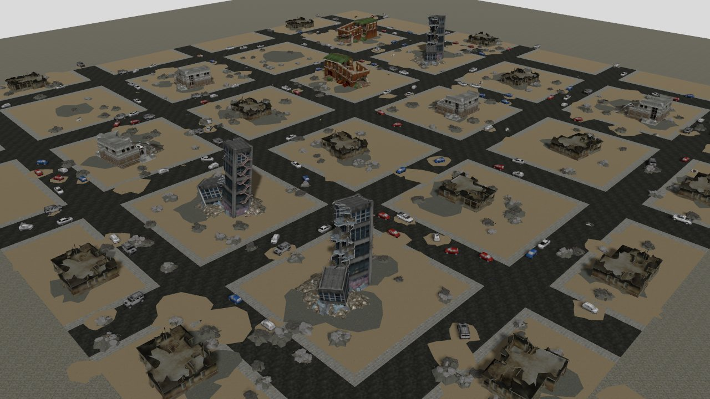
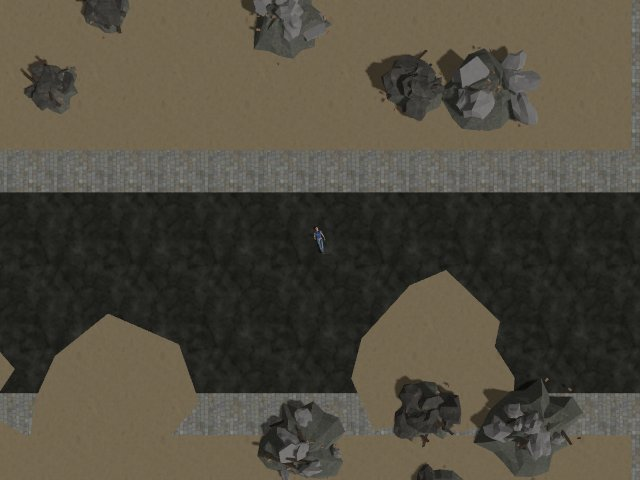
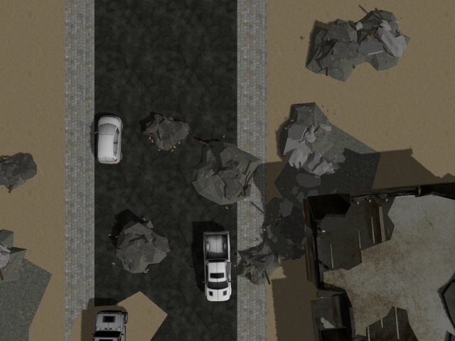
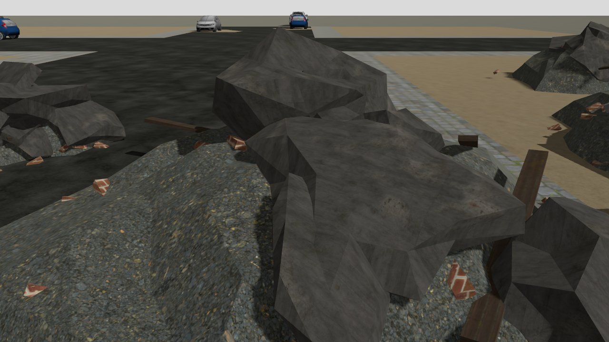
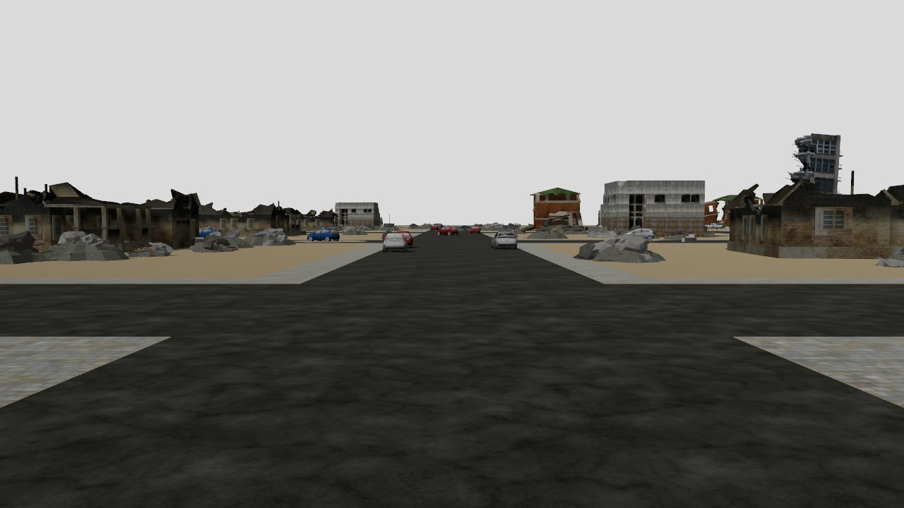

# Yıkık şehir denemesi (yalnız inceleme için)

> **Bu dal birleştirilmeyecek ve PR açılmayacak.** Ekip arkadaşlarının bakması için gönderildi. Projedeki sahneler A1 dalındaki
> (`mikail/A1-sahne-ureticisi`) "yıkık şehir" kurallarıyla üretilir; bu deneme o kurallardan önce yapıldı.



BLM498 İHA sürüsü simülasyonu için 2026-11-17'de hazırlanan **deneme** sahnesi: 300 × 300 m alanda 23 yıkılmış bina, 290 moloz
yığını, caddelere park edilmiş ya da savrulmuş 129 araç; 15 yatan insan ve 15 enkaz yığını hedefi (test sahnesi kuralı, hedef
merkezleri arası ≥ 10 m). Çatlak asfalt caddeler, parke taşı kaldırımlar, tozlu arsalar.

## Neden projede kullanılmıyor

Depo sahibinin 2026-11-17 kararıyla (planlama/kararlar.md) projedeki sahnede enkaz hedefi yalnız **yıkık ev**dir; yıkık evler
dışında enkaza benzeyen nesne (ayrı moloz, başka bina, kule, araç) bulunmaz. Bu denemede arka plan molozu ve yıkık binalar hedef
listesinde olmadığı için, model onları bulduğunda yanlış alarm (FP) sayılırdı; 24 m'lik yıkık sanayi kulesi 30 m'lik uçuş
irtifasına yakındır; düz zemin varsayımı (konum hesabı) ve kısmi örtülme kuralı açısından da ayrıca karar gerekir.

## Görseller

| | |
|---|---|
|  |  |
| İHA kamerası 30 m (640 × 480, 65°): caddede yatan insan (ortada) | İHA kamerası 30 m: moloz, araçlar, yıkık bina köşesi |
|  |  |
| Moloz yığını (programla üretildi), 2 m'den | Cadde seviyesinden |

Hepsi bir arada: [gorseller/pafta.jpg](gorseller/pafta.jpg).

## Sahneyi Gazebo'da açmak

Model ve doku dosyaları depoya girmez (proje kuralı). Kendi başına açılabilen tam arşiv (`blm498_sehir_denemesi_arsiv.tar.gz`,
117 MB; SHA-256 `9a7b24be7fe2ca4c4b5ec44e27362fef4186feeb467ff9424a7819d71815ed9f`) Mikail'den alınır. Sonra:

```bash
cd ~ && tar xzf blm498_sehir_denemesi_arsiv.tar.gz
~/blm498_sehir_denemesi_arsiv/ac.sh
```

## Bu klasörde

| Yol | İçerik |
|---|---|
| `sahne/dunya.sdf` | Gazebo dünyası (model ve dokular `model://` ile; arşivdeki `modeller/` klasörünü ister) |
| `sahne/sahne.json` | Hedef listesi (sözleşme biçiminde: kimlik, sınıf, konum, yönelim, görünüm) |
| `kod/` | Sahneyi üreten deneme betikleri: `sehir_uret3.py` (son sürüm; `sehir_uret2.py` ve `sehir_uret.py` üzerine kurulu), `moloz_ag.py` (doğal moloz ağları), `foto.py`, `canli_kur.py`, `temizle.py` |
| `kod/eski_araclar/` | Betiklerin dayandığı ilk A1 araçları (commit 3bfe683): `sahne_uret.py`, `varlik_kur.py`, `sozlesme_dogrula.py`, ilk varlık listesi |
| `gorseller/` | Fotoğraflar |
| `LISANSLAR.md` | Bütün model ve dokuların lisansları (CC0 ve CC BY 4.0) ve atıflar |

Betikler, depoda `.generated/deneme_sehir/` klasöründen ve eski A1 araçlarıyla çalıştırılmak üzere yazıldı (yollar o düzene göre);
dünya dosyası hazır olduğu için yeniden üretmek gerekmez.
