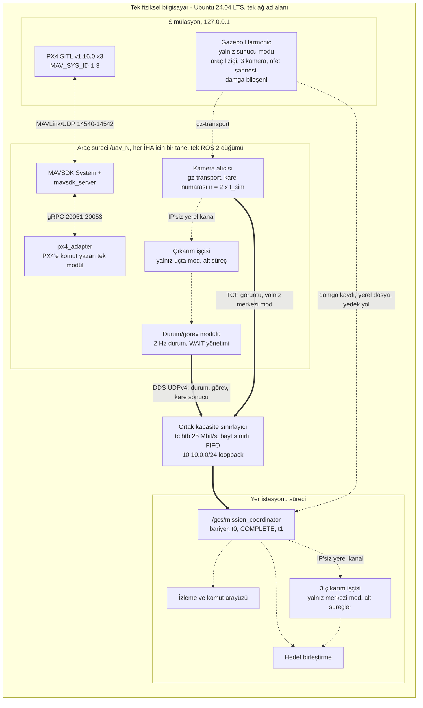
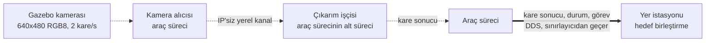
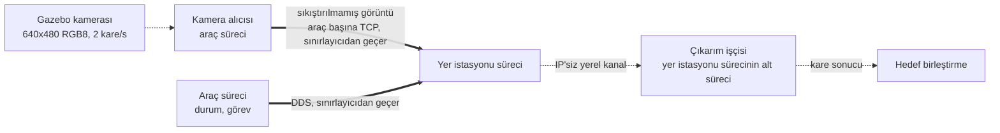
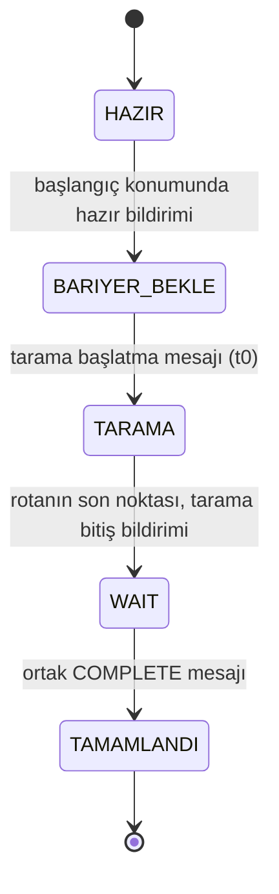
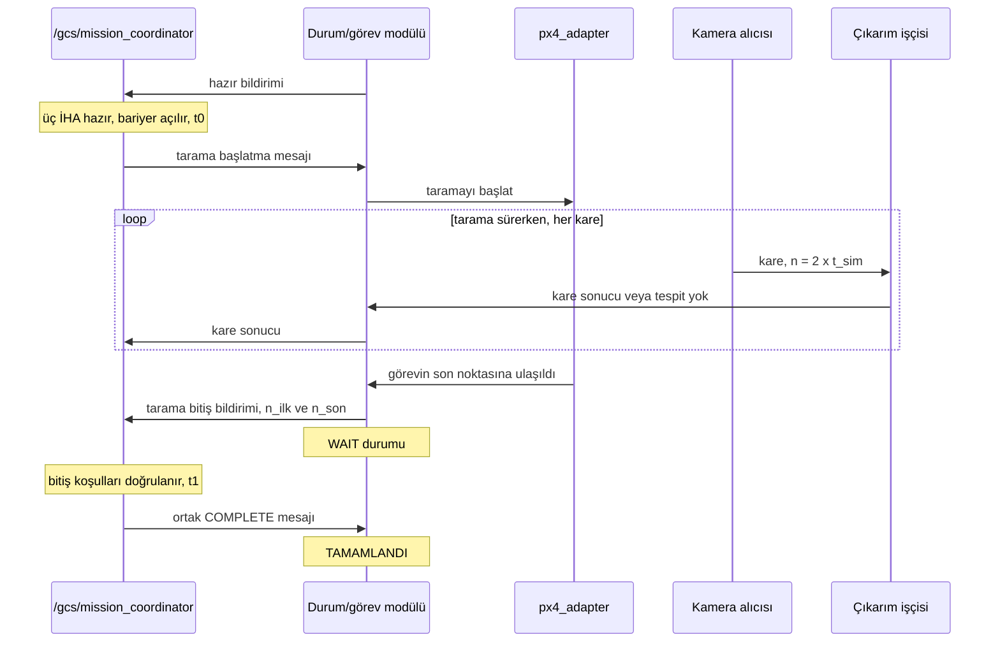

# Mimari

Kaynak: proje el kitabı v1.3.2 (Haberleşme Mimarisi, Şekil 1-2, İletişim ve Telemetri Yönetimi) ve GŞÖA v2 (5.2-5.3 arayüzler, 7. bölüm UML şekilleri). Şemalar belgedeki akışlardan türetilmiştir; belgede olmayan bileşen eklenmemiştir. Ürün yalnız **simülasyondadır**; gerçek uçuş veya gömülü donanım doğrulaması değildir.

## 1. Sistem genel görünümü

Her şey **tek fiziksel bilgisayarda ve tek ağ ad alanında** çalışır. İki tür bağlantı vardır: simülasyon ve araç içi bağlantılar (`127.0.0.1`, ölçülmez) ve **ölçülen sürü ağı** (loopback üzerinde `10.10.0.0/24`, tek ortak kapasite sınırlayıcıdan geçer). Kalın oklar ölçülen sürü ağıdır ve D'ye dahildir; kesikli oklar `127.0.0.1` veya IP kullanmayan yerel kanallardır ve D'ye girmez.

Notlar:
- Araç içi modüller ile çıkarım alt süreçleri arasında ve yer istasyonu bileşenleri arasında **DDS kullanılmaz**; çıkarım alt süreçleriyle iletişim IP kullanmayan yerel kanaldan yürür.
- Kamera alıcısı Gazebo görüntü konusuna `ros_gz_bridge` kullanmadan, gz-transport ile doğrudan abone olur (ölçülen ağın dışında ek DDS katılımcısı oluşmaz).
- Yer istasyonu komutları `swarm_gcs → araç komut konusu → px4_adapter → MAVSDK-Python → MAVLink → PX4` yolundan gider; ikinci bir doğrudan PX4 komut yolu yoktur.
- Telemetri yolu: `PX4 → MAVLink → mavsdk_server → MAVSDK-Python → px4_adapter → durum önbelleği → durum/görev modülü → DDS (2 Hz)`.
- Yazılım üç pakette toplanır: `swarm_msgs` (yalnız mesaj tanımları), `swarm_vehicle` (araç süreci), `swarm_gcs` (yer istasyonu süreci).

## 2. Uçta mod ve merkezi mod

İki mod arasında yalnız **ağdan geçen veri, çıkarımın yapıldığı yer ve kare sonucunun oluştuğu yer** değişir; sahne, rota, tohumlar, kamera, model ağırlıkları, GPU ve çıkarım ayarları aynıdır. Çıkarım iki modda da aynı GPU'da (FP32, batch=1, nms=False, güven eşiği 0,25) yapılır.

**[varsayım]** Her üç geliştirme makinesinde tek GPU vardır; çıkarım işçileri (`cikarim_isci.py`, `device=0`) aynı GPU'yu paylaşır. Birden çok GPU'lu bir makinede cihaz seçimi yapılandırmaya taşınmalıdır.

**Uçta mod:** görüntü ağa çıkmaz, yalnız kare sonuçları, durum ve görev mesajları gider.

**Merkezi mod:** sıkıştırılmamış görüntü araç başına TCP kanalıyla ağdan geçerek yer istasyonuna gider; çıkarım orada yapılır.

Merkezi modda üç kameranın nominal ham yükü simülasyon gerçek zaman faktörü 1 iken `3 × 640 × 480 × 3 × 2 × 8 = 44,2368 Mbit/s`'dir ve 25 Mbit/s profilin üzerindedir; kuyruk oluşabilir. Bu bir yük hesabıdır, profil sonuçlara bakılarak değiştirilmez.

## 3. Araç görev durumları

Üç İHA aynı durum makinesini izler. Tarama başlatma mesajı almadan tarama başlamaz; WAIT durumundan yalnız ortak COMPLETE mesajıyla çıkılır. Dinamik yeniden bölgeleme ve kayıp araç görevini devralma kapsam dışıdır.

HAZIR durumunda rota PX4'e yerden 30 m sabit irtifalı görev (mission) olarak yüklenmiştir.

## 4. Bir koşunun akışı: ortak başlangıçtan ortak tamamlanmaya

Tek bir İHA'nın akışı çizilmiştir, diğer ikisi aynı akışı izler; akış uçta modu gösterir. Merkezi modda çıkarım işçisi yer istasyonu sürecinin alt sürecidir. Alıcıya ulaşmayan kare için üretilen "kare alınamadı" kaydı sadelik için çizilmemiştir.

Ortak COMPLETE için üç koşul gerekir: (1) bütün tarama bitiş bildirimleri alınmış, (2) bildirilen aralıktaki her kare numarası için kare sonucu ya da "kare alınamadı" kaydı yer istasyonunda bulunuyor, (3) nihai hedef birleştirme tamamlanmış. COMPLETE mesajının gönderimi t1'den sonradır ve D'ye girmez. Koşullar zaman aşımı H içinde sağlanmazsa koşu "tamamlanamadı" olarak kaydedilir.

## 5. Ölçüm anları ve ölçütler

| Simge | Tanım |
|---|---|
| t0 | Bariyer açılıp tarama başlatma mesajı yayımlandığı an |
| t1 | Bitiş koşulları doğrulanıp ortak COMPLETE yayımlandığı an |
| T | Toplam görev süresi, `T = t1 − t0` (hazırlık evresi dahil değil) |
| D | t0–t1 penceresinde sınırlayıcıdan geçen toplam veri yükü (MB), sınırlayıcının gönderilmiş bayt sayaçlarının farkı |
| B | Ortalama ağ trafik hızı, `B = 8D/T` (bağlantı kapasitesi değildir) |
| R | Görev düzeyinde hedef tespit oranı, `R = 100 × TP / N`, `N = 30` |
| L | Uçtan uca tepki süresi: kare Gazebo sunucusunda yayımlanmasından sonucun yer istasyonunda kullanılabilir olmasına kadar |
| H | Ortak zaman aşımı, `H = 60 × ⌈2 × max(Tp, Sp + 8Dp/C) / 60⌉` s, pilotlardan hesaplanır ve ana deneylerden önce kilitlenir |

## 6. Ölçülen ağa girenler ve girmeyenler

| Trafik | Ölçülen ağ (D) |
|---|---|
| Araçlar arası ve araç–yer istasyonu DDS mesajları (durum, görev, kare sonucu, "kare alınamadı", komut) | dahil |
| Merkezi mod görüntü kanalı (araç başına TCP), TCP onayları ve yeniden iletimler | dahil |
| DDS keşif ve denetim paketleri, tarama başlatma ve bitiş mesajları | dahil |
| Ortak COMPLETE mesajı ve araçlara ulaşması | dışında (t1'den sonra) |
| Gazebo–PX4 SITL, Gazebo kamerası → kamera alıcısı (gz-transport) | dışında (`127.0.0.1`) |
| PX4 ↔ mavsdk_server (MAVLink/UDP), MAVSDK-Python ↔ mavsdk_server (gRPC) | dışında (`127.0.0.1`) |
| Araç süreci ↔ çıkarım alt süreci, yer istasyonu ↔ çıkarım alt süreçleri (IP'siz yerel kanal) | dışında |
| Yer istasyonunun Gazebo damga kaydını yerel dosyadan okuması (yedek yol) | dışında |

## 7. Kimlikler, portlar ve ağ

| İHA | PX4 `MAV_SYS_ID` | MAVSDK UDP dinleme | Yerel gRPC | ROS 2 ad alanı | Ağ adresi |
|---|---|---|---|---|---|
| İHA 1 | 1 | 14540 | 20051 | `/uav_1` | 10.10.0.1 |
| İHA 2 | 2 | 14541 | 20052 | `/uav_2` | 10.10.0.2 |
| İHA 3 | 3 | 14542 | 20053 | `/uav_3` | 10.10.0.3 |
| Yer istasyonu | — | — | — | `/gcs` | 10.10.0.10 |

Portlar, kimlikler ve adresler tek deney yapılandırma dosyasında (`config/deney.env`) tanımlıdır ve bütün başlatma dosyaları buradan okur. Bütün süreçler aynı ağ ad alanında çalıştığı için her aracın portları farklıdır. Beklenen sistem kimliği doğrulanmadan PX4'e komut verilmez. Yerel gRPC portları (20051–20053) Linux geçici port aralığının (32768–60999) dışındadır: aralıktaki sabit bir port, başka sürecin giden bağlantısına kaynak port olarak atanırsa dinleme başlayamaz.

**Ağ emülasyonu:** loopback üzerinde `10.10.0.0/24`; tek ortak `tc` (htb) sınıfı, 25 Mbit/s birincil profil (deneysel varsayım, sonuçlara bakılarak değiştirilmez) ve bayt cinsinden sınırlı tek FIFO kuyruk (öngörülen 4 MiB, kesin değer ayar pilotunda kilitlenir); sabit ek gecikme ve kasıtlı paket kaybı yok; çoklu yayın yok. **DDS:** tek Fast DDS XML profili (yalnız UDPv4; SHM, data-sharing ve intraprocess kapalı; sabit tek yayın keşif), `rmw_fastrtps_cpp`.
